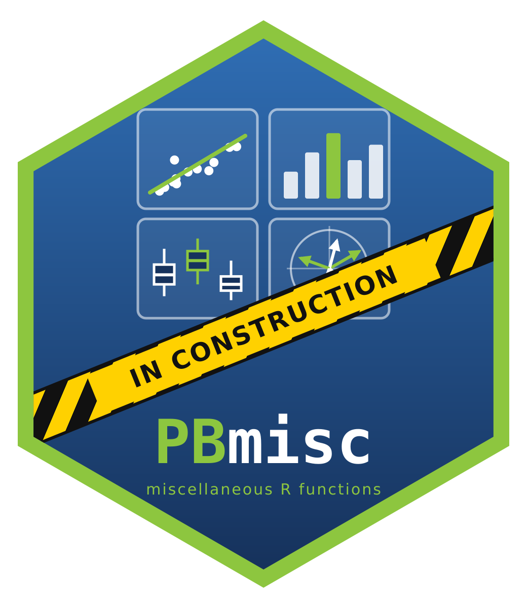

# PBmisc 
Miscellaneous additional R functions for statistical modelling, inference, multidimensional analyses, graphical representation and more ...

PDF documentatuion: https://github.com/badozor/PBmisc/blob/main/trunk/Rdoc/graphics/ggade4.pdf

